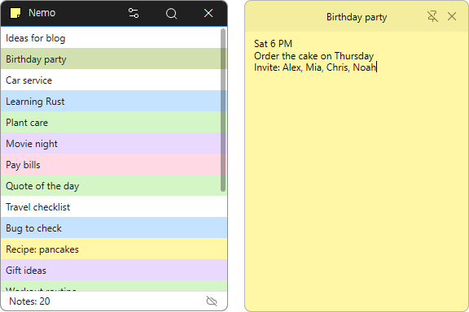

# Nemo

**付箋のように Windows のデスクトップに貼っておける無料のメモソフト。メモはすぐにこの PC に保存され、ログインすれば複数の PC と Web で同じメモを使えます。**

[English](README.md) · [한국어](README.ko.md) · [简体中文](README.zh-CN.md) · 日本語 · [Español](README.es.md) · [Português (Brasil)](README.pt-BR.md) · [Français](README.fr.md)

> この文書は翻訳版です。内容に違いがある場合は[韓国語版](README.ko.md)が基準となります。

## 概要

Nemo は、思いついたことをメモに書いてデスクトップに貼っておくソフトです。メモはタイトルと本文からなり、手を止めると自動で保存されます。メモごとに色を決めたり、ピンを刺してほかのウィンドウの上に表示しておいたりでき、位置・サイズ・ピンは次に起動したときもそのまま戻ります。

メモはまず **この PC に保存** されるので、ログインしなくても、インターネットがつながらなくてもそのまま使えます。Kilho.net アカウントでログインするとメモがサーバーと同期され、ほかの PC の Nemo や [Web Memo](https://webmemo.kilho.net) でも同じメモを見たり編集したりできます。

## 主な機能

- **デスクトップのメモ** — メモのウィンドウはタスクバーや Alt+Tab に並ばず、一覧ウィンドウを閉じてもデスクトップに残ります。
- **自動保存** — 入力を止めて 3 秒たつか、ほかの場所をクリックすると保存されます。保存ボタンはありません。
- **位置を記憶** — メモの位置・サイズ・ピン、開いていたメモを覚えておき、次回の起動時にそのまま表示します。
- **6 色** — 標準 · 黄 · 緑 · 青 · 紫 · ピンク。一覧でも行の背景がその色になるので、ひと目で見分けられます。
- **常に手前** — ピンを刺したメモはほかのウィンドウに隠れません。
- **メモを検索** — 一覧ウィンドウの虫めがねでタイトルと本文を探します。
- **並べ替え** — 一覧でメモをドラッグして順番を変えられます。決めた順番はログインしたほかの PC にもそのまま反映されます。
- **新しいメモのショートカット** — どのソフトを使っていても **Ctrl+Shift+N** ですぐ新しいメモを開きます。キーは変更できます。
- **サーバーなしでも使える** — ログインは任意です。ログアウトしても、この PC のメモはそのまま残ります。
- **複数の PC と Web で同期** — ログインすると、保存の 2 秒後、10 分ごと、または **今すぐ同期** でサーバーと合わせます。同じメモを 2 か所で編集した場合はどちらも捨てず、一方を **競合コピー** として両方残します。
- **ブラウザーで安全にログイン** — パスワードを Nemo に入力しません。ふだん使っているブラウザーで Kilho.net アカウントにログインします(OAuth 2.0 + PKCE)。
- **絵文字** — タイトルと本文に絵文字を入れられます。
- **22 言語** — Windows の表示言語に合わせ、設定で選ぶこともできます。

## ダウンロード / インストール

| 種類 | リンク |
|---|---|
| インストーラー | [ダウンロード](https://down.kilho.net/nemo?lang=ja) |
| ポータブル (ZIP) | [ダウンロード](https://down.kilho.net/nemo?lang=ja&nosetup) |

インストーラー版は初めてのインストール時に **起動時に実行** がオンになります。ポータブル版は ZIP を展開して `Nemo.exe` を実行するだけです。**起動時に実行** はインストール版でのみ使えます。ポータブル版はメモをプログラムと同じフォルダーに保存するので、フォルダーごと移せばメモも一緒に移ります。

## 使い方

### はじめて使う

1. Nemo を起動します。一覧ウィンドウが開き、通知領域(トレイ)に Nemo のアイコンが表示されます。
2. 一覧の空いている所かトレイアイコンを右クリックし、**新しいメモ** を選びます。(どこでも **Ctrl+Shift+N** を押してもかまいません。)
3. 新しいメモはタイトル欄から開きます。タイトルを書いて **Enter** を押すと本文に移ります。
4. 本文を書きます。手を止めると 3 秒後に保存され、一覧にメモが表示されます。
5. メモはデスクトップのどこに置いてもかまいません。タイトルバーをドラッグして移動し、端をドラッグしてサイズを変えます。
6. 見終わったらメモの **✕** を押します。保存して閉じます。もう一度見るには一覧でそのメモをダブルクリックします。

### 画面構成

**一覧ウィンドウ**

| 要素 | 説明 |
|---|---|
| 虫めがね(キャプション) | メモを検索。タイトルと本文から探し、**ESC** で閉じます |
| 歯車(キャプション) | 設定 |
| ✕(キャプション) | 一覧ウィンドウをトレイに隠します。Nemo は終了しません |
| メモ一覧 | 新しいメモが一番上に付き、ドラッグで順番を変えられます。行の背景はメモの色です。**↑**・**↓** で選んだ行を移し、ダブルクリックでメモが開きます。スクロールバーはマウスを乗せたときやスクロール中だけ表示されます |
| ステータスバー左 | **メモ n件** |
| ステータスバー右の雲アイコン | サーバーの接続状態。マウスを乗せると **このPCにのみ保存** · **サーバーに接続済み (アカウント)** · **最終同期** を表示し、クリックすると設定の **サーバー** が開きます |

**メモウィンドウ**

| 要素 | 説明 |
|---|---|
| タイトルバー | ドラッグでメモを移動。タイトルを 2 回クリックするかダブルクリックでタイトルを編集。右クリックでメモのメニュー |
| ピン | **常に手前** のオン/オフ。オフは斜線の入ったピンで表示されます |
| ✕ | 保存して閉じる |
| 本文 | メモの内容。**Tab** で空白 4 つを入れます。スクロールバーはマウスを乗せたときやスクロール中だけ表示されます |
| 端 | ドラッグしてサイズ調整 |

**右クリックメニュー**

| メニュー | 場所 | 働き |
|---|---|---|
| **新しいメモ** | 一覧 · トレイ | 空のメモを開きます |
| **一覧** | トレイ(一覧ウィンドウが隠れているとき) | 一覧ウィンドウをもう一度開きます |
| **編集** | 一覧(メモの上) · メモのタイトルバー | メモを開きます / タイトルを編集します |
| **削除** | 一覧(メモの上) · メモのタイトルバー | 一度確認してから削除します |
| **色 ▸** | 一覧(メモの上) · メモのタイトルバー | 6 色から選びます。すぐに保存されます |
| **設定** | 一覧 · トレイ | 設定ウィンドウ |
| **Kilho.net** | 一覧 · トレイ | Nemo の紹介ページ |
| **終了** | 一覧 · トレイ | 一度確認してから Nemo を終了します。開いていたメモは次回の起動時に再び表示されます |

### こんなときは

**仕事中に思いついたことをすぐ書き留めたいとき**
ほかのソフトを使っている途中でも **Ctrl+Shift+N** を押せば、新しいメモが手前に表示されます。タイトルを書いて Enter、本文を書いてそのままにしておけば保存されます。

**いつも見えるように貼っておきたいとき**
メモのピンを押すと **常に手前** がオンになり、ほかのウィンドウを開いても隠れません。もう一度押すとオフになります。ピンの状態も次回の起動時にそのまま戻ります。

**ほかのウィンドウの後ろに隠れたメモを出したいとき**
トレイの Nemo アイコンを左クリックすると、開いているメモだけがすべて手前に出てきます。一覧ウィンドウはそのままです。開いているメモが一つもないときは一覧ウィンドウが開きます。メモが開いているときに一覧ウィンドウが必要なら、トレイアイコンを右クリックして **一覧** を選んでください。

**メモを種類ごとに分けたいとき**
やることは黄、仕事は青のように色を決めておきましょう。メモのタイトルバーか一覧のメモを右クリック → **色 ▸** で選ぶと、メモと一覧の行の色がすぐに変わります。

**よく見るメモを上に置きたいとき**
一覧でメモをマウスで押し、置きたい位置までドラッグして離します。一覧の端までドラッグすると自動でスクロールします。決めた順番はすぐ保存され、ログインしていればほかの PC の一覧も同じ順番になります。新しく作ったメモは一番上に付きます。

**メモが増えて探しにくいとき**
一覧ウィンドウのキャプションの虫めがねを押して、探したい言葉を入力します。タイトルか本文にその言葉を含むメモだけが残ります。**ESC** を押すと検索が閉じて、すべての一覧に戻ります。

**タイトルだけ変えたいとき**
メモのタイトルを一度クリックし、少ししてからもう一度クリックする(エクスプローラーで名前を変えるときと同じ)、ダブルクリックする、またはタイトルバーを右クリック → **編集** を選びます。**Enter** で確定、**Esc** で元のタイトルに戻ります。ほかの場所をクリックしても入力した内容で確定します。

**メモで字下げしたいとき**
本文で **Tab** を押すと空白が 4 つ入ります。間違えて押したときは Ctrl+Z を一度押せば 4 つまとめて消えます。

**一覧は片付けてメモだけ残したいとき**
一覧ウィンドウの **✕** を押すとトレイに入り、メモはデスクトップにそのまま残ります。Nemo を完全に終了するには、トレイメニューの **終了** を選びます。

**次も同じ場所に**
メモを開いたまま Windows をシャットダウンしたり Nemo を終了したりしても、次に起動すると開いていたメモが同じ位置・同じサイズで再び表示されます。モニター構成が変わって画面の外に出てしまう場合は、画面の中に移して表示します。

**PC を起動するたびにメモを見たいとき**
設定の **一般** で **起動時に実行** をオンにします(インストーラー版は最初からオンです)。この項目はインストール版でのみ使え、ポータブル版では淡色表示になります。Windows が起動すると一覧ウィンドウを出さずにトレイで静かに起動し、開いておいたメモだけがデスクトップに表示されます。

**会社の PC と自宅の PC で同じメモを使いたいとき**
両方の PC で設定の **サーバー** から **ログイン** を押します。ブラウザーが開いたら Kilho.net アカウントでログインし、「ログインしました」と表示されたらそのウィンドウを閉じて Nemo に戻ります。以後は保存の 2 秒後と 10 分ごとに自動で同期されます。すぐに同期したいときは **今すぐ同期** を押してください。

**PC から離れた場所でメモを見たいとき**
Nemo でログインしたアカウントで [Web Memo](https://webmemo.kilho.net) に入ると、同じメモを見たり編集したりできます。Web での変更は次の同期のときに Nemo のメモにも反映されます。

**2 台の PC で同じメモを別々に編集したとき**
どちらも上書きしません。一方は元のメモとして、もう一方はタイトルの末尾に **(競合コピー)** が付いた新しいメモとして両方残ります。内容を比べて一つにまとめ、いらない方を削除してください。

**ログインする前から使っているメモがあるとき**
ログインすると、この PC のメモはそのアカウントにアップロードされ、サーバーのメモはこの PC にダウンロードされて一つの一覧にまとまります。以前ほかのアカウントで使っていた PC なら、先に「別のアカウントでログインしました。このPCのメモをこのアカウントに統合しますか?」と確認し、**いいえ** を選ぶとログインしません。

**同期をやめてこの PC だけで使いたいとき**
設定の **サーバー** で **ログアウト** を押します。この PC のメモはそのまま残り、ステータスバーは **このPCにのみ保存** に変わります。サーバーのメモやほかの PC には影響しません。

**インターネットが使えない場所で使うとき**
メモは常にこの PC に先に保存されるので、いつもどおり使ってください。インターネットに再びつながると、次の同期のときにサーバーへアップロードされます。

**新しいメモのショートカットを変えたいとき**
設定の **一般** で **ショートカット（新しいメモ）** 欄を押すと「キーを押してください」に変わります。好きな組み合わせ(例: Ctrl+Alt+M)を押すとすぐに適用されます。ほかのソフトがすでに使っているキーなら知らせてくれるので、別の組み合わせを選んでください。

**USB メモリーに入れて持ち歩きたいとき**
ポータブル版を USB メモリーに展開して実行してください。メモが同じフォルダーに保存されるので、どの PC に挿しても同じメモが開きます。

**Nemo をアンインストールして入れ直すとき**
インストーラー版をアンインストールしてもメモは消えません。もう一度インストールすれば、使っていたメモがそのまま出てきます。

**Windows をシャットダウンするとき**
Nemo はシャットダウンを止めません。書いていたメモを保存してから一緒に終了します。

**Nemo をもう一度起動したのにウィンドウが見えないとき**
Nemo は一度に一つしか起動しません。すでに起動しているときにもう一度起動すると、トレイに隠れていた一覧ウィンドウが手前に出てきます。

## 設定

一覧ウィンドウの歯車か、右クリックメニューの **設定** から開きます。変更はすぐに適用され、OK ボタンはありません。

| 分類 | 項目 | 既定値 |
|---|---|---|
| 一般 | 起動時に実行 | インストーラー版はオン(ポータブル版では使えません) |
| 一般 | ショートカット（新しいメモ） | Ctrl+Shift+N |
| 一般 | 言語 | システム(Windows の表示言語) |
| サーバー | アカウント — ログイン / ログアウト | ログインしない |
| サーバー | 同期 — 最終同期の時刻、今すぐ同期 | ログインしているときだけ表示されます |
| 情報 | バージョン · 作者 · ホームページ · ライセンス | — |

言語は **システム** なら Windows の表示言語に合わせ、一覧から選ぶとその場で切り替わります。アラビア語は右から左に表示されます。

## 動作環境

- Windows 7 · 8 · 8.1 · 10 · 11(32 ビット · 64 ビット)
- Windows 7 では Service Pack 1(SP1)と最新の Windows Update が必要です。
- 追加のランタイムは不要です。
- サーバー同期を使うときだけ、インターネット接続と Kilho.net アカウントが必要です。

## アップデート

Nemo は自動的にはアップデート**しません**。起動時に新バージョンの有無を確認して案内画面を表示し、**[はい]** を押すとダウンロードページが開いてプログラムが終了します。新バージョンは内部検証の後に手動で配布され、[Nemo ページ](https://kilho.net/nemo)で告知されます。[アップデートポリシー](https://en.kilho.net/archives/notice/2940)をご覧ください。

## ライセンス

Nemo は**フリーウェア**です。会社、家庭、官公庁、学校など、どこでも制限なく無料で使え、自由に再配布できます。

## リンク

- Web サイト: <https://kilho.net/nemo>
- Nemo ホームページ: <https://nemo.kilho.net>
- Web Memo: <https://webmemo.kilho.net>
- フォーラム: <https://kilho.top/forum/qna>
- X (Twitter): <https://www.twitter.com/kilhonet>

© KILHO.NET
