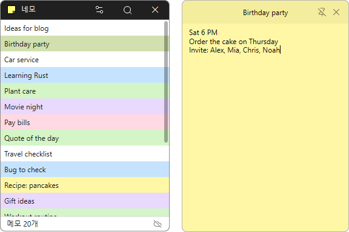

# 네모

**포스트잇처럼 바탕화면에 붙여 두는 무료 메모 프로그램. 이 PC 에 바로 저장되고, 로그인하면 여러 PC 와 웹에서 같은 메모를 씁니다.**

[English](README.md) · 한국어 · [简体中文](README.zh-CN.md) · [日本語](README.ja.md) · [Español](README.es.md) · [Português (Brasil)](README.pt-BR.md) · [Français](README.fr.md)

## 개요

네모는 떠오른 생각을 쪽지에 적어 바탕화면에 붙여 두는 메모 프로그램입니다. 쪽지는 제목과 본문으로 되어 있고, 손을 멈추면 알아서 저장됩니다. 쪽지마다 색을 정하고 핀을 꽂아 다른 창 위에 띄워 둘 수 있으며, 닫았던 자리·크기·핀은 다음에 켤 때 그대로 돌아옵니다.

메모는 먼저 **이 PC 에 저장**되므로 로그인하지 않아도, 인터넷이 끊겨도 그대로 씁니다. 길호넷 계정으로 로그인하면 메모가 서버와 동기화되어 다른 PC 의 네모와 [웹 메모](https://webmemo.kilho.net)에서도 같은 메모를 보고 고칠 수 있습니다.

## 주요 기능

- **바탕화면 쪽지** — 쪽지 창은 작업 표시줄과 Alt+Tab 을 차지하지 않고, 목록 창을 닫아도 바탕화면에 남습니다.
- **자동 저장** — 입력을 멈추고 3초가 지나거나 다른 곳을 누르면 저장됩니다. 저장 단추가 없습니다.
- **자리 기억** — 쪽지의 위치·크기·핀, 그리고 열려 있던 쪽지를 기억했다가 다음 실행 때 그대로 다시 띄웁니다.
- **색 6가지** — 기본 · 노랑 · 초록 · 파랑 · 보라 · 분홍. 목록에서도 줄 배경이 그 색이라 한눈에 구분됩니다.
- **항상 위** — 핀을 꽂은 쪽지는 다른 창에 가려지지 않습니다.
- **메모 검색** — 목록 창의 돋보기로 제목과 본문을 찾습니다.
- **새 메모 단축키** — 어떤 프로그램을 쓰고 있든 **Ctrl+Shift+N** 으로 바로 새 쪽지를 엽니다. 키는 바꿀 수 있습니다.
- **서버 없이도 사용** — 로그인은 고를 수 있습니다. 로그아웃해도 이 PC 의 메모는 그대로 남습니다.
- **여러 PC 와 웹에서 동기화** — 로그인하면 저장하고 2초 뒤, 10분마다, 또는 **[지금 동기화]** 로 서버와 맞춥니다. 두 곳에서 같은 메모를 고쳤으면 어느 쪽도 버리지 않고 **충돌 사본**으로 둘 다 남깁니다.
- **브라우저로 안전하게 로그인** — 비밀번호를 네모에 입력하지 않습니다. 평소 쓰는 브라우저에서 길호넷 계정으로 로그인합니다(OAuth 2.0 + PKCE).
- **이모지** — 제목과 본문에 이모지를 넣을 수 있습니다.
- **22개 언어** — Windows 표시 언어를 따르고, 환경설정에서 직접 고를 수도 있습니다.

## 다운로드 / 설치

| 구분 | 링크 |
|---|---|
| 설치 파일 | [다운로드](https://down.kilho.net/nemo?lang=ko) |
| 무설치 (ZIP) | [다운로드](https://down.kilho.net/nemo?lang=ko&nosetup) |

설치판은 처음 설치할 때 **부팅시 실행**이 켜집니다. 무설치판은 ZIP 을 풀고 `Nemo.exe` 를 실행하면 됩니다. 무설치판은 메모를 프로그램과 같은 폴더에 저장하므로 폴더째 옮기면 메모도 함께 옮겨집니다.

## 사용법

### 처음 사용하기

1. 네모를 실행합니다. 목록 창이 뜨고 알림 영역(트레이)에 네모 아이콘이 생깁니다.
2. 목록의 빈 곳이나 트레이 아이콘을 오른쪽 클릭하고 **새 메모**를 고릅니다. (어디서든 **Ctrl+Shift+N** 을 눌러도 됩니다.)
3. 새 쪽지는 제목 칸부터 열립니다. 제목을 쓰고 **Enter** 를 누르면 본문으로 넘어갑니다.
4. 본문을 씁니다. 손을 멈추면 3초 뒤 저장되고 목록에 메모가 나타납니다.
5. 쪽지는 바탕화면 아무 곳에 두면 됩니다. 제목줄을 끌어 옮기고, 가장자리를 끌어 크기를 바꿉니다.
6. 다 봤으면 쪽지의 **✕** 를 누릅니다. 저장하고 닫힙니다. 다시 보려면 목록에서 그 메모를 더블클릭합니다.

### 화면 구성

**목록 창**

| 요소 | 설명 |
|---|---|
| 돋보기 (캡션) | 메모 검색. 제목과 본문에서 찾고, **ESC** 로 닫습니다 |
| 톱니바퀴 (캡션) | 환경설정 |
| ✕ (캡션) | 목록 창을 트레이로 숨깁니다. 네모는 꺼지지 않습니다 |
| 메모 목록 | 만든 순서대로 보이고, 줄 배경은 메모의 색입니다. 더블클릭하면 쪽지가 열립니다 |
| 상태 표시줄 왼쪽 | **메모 n개** |
| 상태 표시줄 오른쪽 구름 아이콘 | 서버 연결 상태. 마우스를 올리면 **이 PC 에만 저장** · **서버 연결됨(계정)** · **마지막 동기화** 를 보여 주고, 누르면 환경설정 **서버** 가 열립니다 |

**쪽지 창**

| 요소 | 설명 |
|---|---|
| 제목줄 | 끌면 쪽지가 옮겨집니다. 제목을 두 번 누르거나 더블클릭하면 제목을 고칩니다. 오른쪽 클릭하면 쪽지 메뉴 |
| 핀 | **항상 위** 켜기/끄기. 꺼짐은 사선 그어진 핀으로 보입니다 |
| ✕ | 저장하고 닫기 |
| 본문 | 메모 내용. 마우스를 올리면 스크롤 막대가 나타납니다 |
| 가장자리 | 끌어서 크기 조절 |

**오른쪽 클릭 메뉴**

| 메뉴 | 있는 곳 | 하는 일 |
|---|---|---|
| **새 메모** | 목록 · 트레이 | 빈 쪽지를 엽니다 |
| **목록** | 트레이 (목록 창이 숨어 있을 때) | 목록 창을 다시 엽니다 |
| **수정** | 목록(메모 위) · 쪽지 제목줄 | 쪽지를 엽니다 / 제목을 고칩니다 |
| **삭제** | 목록(메모 위) · 쪽지 제목줄 | 한 번 물어본 뒤 지웁니다 |
| **색상 ▸** | 목록(메모 위) · 쪽지 제목줄 | 6가지 색 중에서 고릅니다. 바로 저장됩니다 |
| **환경설정** | 목록 · 트레이 | 환경설정 창 |
| **만든이 오길호** | 목록 · 트레이 | 네모 소개 페이지 |
| **종료하기** | 목록 · 트레이 | 한 번 물어본 뒤 네모를 끕니다. 열린 쪽지는 다음 실행 때 다시 뜹니다 |

### 이럴 때 이렇게

**일하다가 떠오른 것을 바로 적고 싶을 때**
다른 프로그램을 쓰던 중이라도 **Ctrl+Shift+N** 을 누르면 새 쪽지가 앞에 뜹니다. 제목을 쓰고 Enter, 본문을 쓰고 그냥 두면 저장됩니다.

**늘 보이게 붙여 두고 싶을 때**
쪽지의 핀을 누르면 **항상 위** 가 켜져 다른 창을 띄워도 가려지지 않습니다. 다시 누르면 꺼집니다. 핀 상태도 다음 실행 때 그대로 돌아옵니다.

**쪽지를 다른 창 뒤에 숨겨 둔 채 꺼내 보고 싶을 때**
트레이의 네모 아이콘을 왼쪽 클릭하면 떠 있는 쪽지만 모두 앞으로 나옵니다. 목록 창은 그대로 둡니다. 목록 창이 필요하면 트레이 아이콘을 오른쪽 클릭해 **목록** 을 고르세요.

**메모를 종류별로 나눠 보고 싶을 때**
할 일은 노랑, 업무는 파랑처럼 색을 정해 두세요. 쪽지 제목줄이나 목록의 메모를 오른쪽 클릭 → **색상 ▸** 에서 고르면 쪽지와 목록의 줄 색이 바로 바뀝니다.

**메모가 많아져서 찾기 어려울 때**
목록 창 캡션의 돋보기를 누르고 찾을 말을 입력합니다. 제목이나 본문에 그 말이 든 메모만 남습니다. **ESC** 를 누르면 검색이 닫히고 전체 목록으로 돌아갑니다.

**제목만 고치고 싶을 때**
쪽지 제목을 한 번 누르고 잠시 뒤 한 번 더 누르거나(탐색기에서 이름 바꾸듯), 더블클릭하거나, 제목줄 오른쪽 클릭 → **수정** 을 고릅니다. **Enter** 는 확정, **Esc** 는 원래 제목으로 되돌립니다. 다른 곳을 눌러도 입력한 대로 확정됩니다.

**목록 창은 치우고 쪽지만 두고 싶을 때**
목록 창의 **✕** 를 누르면 트레이로 들어가고 쪽지들은 바탕화면에 그대로 남습니다. 네모를 완전히 끄려면 트레이 메뉴의 **종료하기** 를 고릅니다.

**쪽지를 화면 어디에 두든 다음에도 그 자리에**
쪽지를 닫지 않은 채 Windows 를 끄거나 네모를 종료해도, 다음에 켜면 열려 있던 쪽지가 같은 자리·같은 크기로 다시 뜹니다. 모니터 구성이 바뀌어 화면 밖에 있게 되면 화면 안으로 옮겨 띄웁니다.

**PC 를 켤 때마다 메모를 보고 싶을 때**
환경설정 **일반** 의 **부팅시 실행** 을 켭니다(설치판은 처음부터 켜져 있습니다). Windows 가 시작되면 목록 창 없이 트레이로 조용히 켜지고, 열어 두었던 쪽지만 바탕화면에 나타납니다.

**회사 PC 와 집 PC 에서 같은 메모를 쓰고 싶을 때**
두 PC 모두 환경설정 **서버** 에서 **로그인** 을 누릅니다. 브라우저가 열리면 길호넷 계정으로 로그인하고, "로그인되었습니다" 화면이 뜨면 그 창을 닫고 네모로 돌아오면 됩니다. 이후로는 메모를 저장하고 2초 뒤, 그리고 10분마다 알아서 맞춰집니다. 바로 맞추고 싶으면 **[지금 동기화]** 를 누르세요.

**PC 가 없는 곳에서 메모를 보고 싶을 때**
네모에서 로그인한 계정으로 [웹 메모](https://webmemo.kilho.net)에 들어가면 같은 메모를 보고 고칠 수 있습니다. 웹에서 고친 내용은 다음 동기화 때 네모의 쪽지에도 들어옵니다.

**두 PC 에서 같은 메모를 따로 고쳤을 때**
어느 한쪽을 덮어쓰지 않습니다. 한쪽은 원래 메모로, 다른 한쪽은 제목 끝에 **(충돌 사본)** 이 붙은 새 메모로 둘 다 남습니다. 내용을 비교해 하나로 합친 뒤 필요 없는 쪽을 지우면 됩니다.

**로그인하기 전부터 써 온 메모가 있을 때**
로그인하면 이 PC 에 있던 메모는 그 계정으로 올라가고, 서버에 있던 메모는 이 PC 로 내려와 하나로 합쳐집니다. 전에 다른 계정으로 쓰던 PC 라면 "다른 계정으로 로그인했습니다. 이 PC 의 메모를 이 계정에 합칠까요?" 라고 먼저 묻고, **[아니오]** 를 누르면 로그인하지 않습니다.

**서버에서 빠지고 이 PC 에서만 쓰고 싶을 때**
환경설정 **서버** 에서 **로그아웃** 을 누릅니다. 이 PC 의 메모는 그대로 남고, 그때부터 상태 표시줄이 **이 PC 에만 저장** 으로 바뀝니다. 서버의 메모와 다른 PC 는 건드리지 않습니다.

**인터넷이 안 되는 곳에서 쓸 때**
메모는 늘 이 PC 에 먼저 저장되므로 평소처럼 쓰면 됩니다. 인터넷이 다시 연결되면 다음 동기화 때 서버로 올라갑니다.

**새 메모 단축키를 바꾸고 싶을 때**
환경설정 **일반** 의 **단축키(새 메모)** 칸을 누르면 "키를 누르세요" 로 바뀝니다. 원하는 조합(예: Ctrl+Alt+M)을 누르면 바로 적용됩니다. 다른 프로그램이 이미 쓰는 키라면 그렇다고 알려 주니 다른 조합을 고르세요.

**USB 에 넣고 다니며 쓰고 싶을 때**
무설치판을 USB 에 풀어 두고 실행하세요. 메모가 같은 폴더에 저장되어 USB 를 꽂는 PC 마다 같은 메모가 열립니다.

**네모를 지우고 다시 설치할 때**
설치판을 제거해도 메모는 지워지지 않습니다. 다시 설치하면 쓰던 메모가 그대로 나옵니다.

**Windows 를 끌 때**
네모는 종료를 막지 않습니다. 쓰던 쪽지를 저장한 뒤 함께 꺼집니다.

**네모를 다시 실행했는데 창이 안 보일 때**
네모는 한 번에 하나만 실행됩니다. 이미 실행 중일 때 다시 실행하면 트레이에 숨어 있던 목록 창이 앞으로 나옵니다.

## 설정

목록 창의 톱니바퀴나 오른쪽 클릭 메뉴의 **환경설정** 에서 엽니다. 바꾸는 즉시 적용되고 확인 단추는 없습니다.

| 분류 | 항목 | 기본값 |
|---|---|---|
| 일반 | 부팅시 실행 | 설치판은 켜짐, 무설치판은 꺼짐 |
| 일반 | 단축키(새 메모) | Ctrl+Shift+N |
| 일반 | 언어 | 시스템 (Windows 표시 언어) |
| 서버 | 계정 — 로그인 / 로그아웃 | 로그인 안 함 |
| 서버 | 동기화 — 마지막 동기화 시각, [지금 동기화] | 로그인했을 때만 보입니다 |
| 정보 | 버전 · 만든이 · 홈페이지 · 라이선스 | — |

언어는 **시스템** 이면 Windows 표시 언어를 따르고, 목록에서 고르면 그 자리에서 바뀝니다. 아랍어는 오른쪽에서 왼쪽으로 표시됩니다.

## 요구 사항

- Windows 7 · 8 · 8.1 · 10 · 11 (32비트 · 64비트)
- Windows 7 은 서비스 팩 1(SP1)과 최신 Windows 업데이트가 설치되어 있어야 합니다.
- 별도 런타임이 필요 없습니다.
- 서버 동기화를 쓸 때만 인터넷 연결과 길호넷 계정이 필요합니다.

## 업데이트

네모는 자동으로 업데이트하지 **않습니다**. 실행할 때 새 버전이 있는지 확인해 안내 창을 띄우고, **[예]** 를 누르면 다운로드 페이지가 열리면서 프로그램이 종료됩니다. 새 버전은 내부 검증 후 수동으로 배포되고 [네모 페이지](https://kilho.net/nemo)에 공지됩니다. [업데이트 정책 안내](https://kilho.net/archives/notice/2940)를 참고하세요.

## 라이선스

네모는 **프리웨어**입니다. 회사, 집, 관공서, 학교 어디서나 제약 없이 무료로 쓸 수 있고, 자유롭게 재배포할 수 있습니다.

## 링크

- 웹사이트: <https://kilho.net/nemo>
- 네모 홈페이지: <https://nemo.kilho.net>
- 웹 메모: <https://webmemo.kilho.net>
- 포럼: <https://kilho.top/forum/qna>
- X (Twitter): <https://www.twitter.com/kilhonet>

© KILHO.NET
